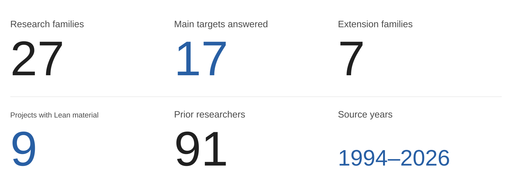

# Aurantium · Mathematics

**Mathematical research · Proofs, counterexamples and extensions**

[中文](README.md) · [English](README.en.md) · [Lean sources](formalizations/README.md) · [Background](REPORT.zh.md) · [References](SOURCES.md)

---

  <picture>
    <source media="(max-width: 650px)" srcset="assets/goethe-epigraph.mobile.svg">
    
  </picture>

A collection of **27 result families** in combinatorics, graph theory, polynomials and asymptotic analysis. Highlights include **a proof of the Katthän’s polynomiality conjecture, exact Catalan–Hankel degree formulas for the Wang–Xin conjecture in Cigler’s formulation, another proof of Karp’s second-order real-rootedness conjecture, and the sharp uniform bound of 23 colours for K₆ chains**.

<picture>
  <source media="(max-width: 650px)" srcset="assets/research-overview.current.mobile.en.svg">
  
</picture>

**Research areas:** extremal graph theory · algebraic combinatorics · commutative algebra · discrete geometry · real-rooted polynomials · enumerative geometry · asymptotic analysis · formalized mathematics

**Methods and tools:** determinants and generating functions · SAGBI bases and toric degeneration · root interlacing and positivity · exact certificates · Lean 4 / mathlib · Python / SymPy · C++17

[Conjecture names, original sources and results](CONJECTURES.md) · [The 91 researchers and their work](PRIOR_RESEARCH.md) · [Statistical definitions](METHODS.md)

## Newly public proof candidate · 4 November 2026

**[Ferroni–McGinnis unit-circle conjecture · proof candidate](https://github.com/Aurantium-47/ferroni-mcginnis-unit-circle/tree/d9b2bc10e2c8efef8765542f099ea9432ac45de9)** · [Conjecture 4.5](https://arxiv.org/html/2202.11808v2#S4.SS2) · Polynomial zeros

**Every positive integer capacity vector → all zeros on |x| = 1.** The analytic manuscript covers the weighted-permutation polynomial for every n ≥ 1 and 1 ≤ k ≤ n, including unequal capacities. Constant polynomials have no zeros.

**Review and priority:** Two independent AI reviews found no mathematical gap; this remains a **proof candidate without human peer review or formal verification**. A September 2026 MathOverflow comment links a possible earlier solution whose content could not be inspected. **Novelty and priority remain unresolved; neither is claimed.** [Review status](https://github.com/Aurantium-47/ferroni-mcginnis-unit-circle/blob/d9b2bc10e2c8efef8765542f099ea9432ac45de9/docs/REVIEW_STATUS.md) · [Sources and earlier-solution lead](https://github.com/Aurantium-47/ferroni-mcginnis-unit-circle/blob/d9b2bc10e2c8efef8765542f099ea9432ac45de9/docs/SOURCES.md)

Proof map and reproducible checks

- **[Proof](https://github.com/Aurantium-47/ferroni-mcginnis-unit-circle/blob/d9b2bc10e2c8efef8765542f099ea9432ac45de9/docs/PROOF.md):** A path-matrix determinant and Gauss–Lucas locate the transformed roots in (−2,2); the classical Grace–Walsh–Szegő theorem and reciprocal symmetry extend the conclusion to all positive integer capacities. The recurrence, generating function and classical tools are credited to prior work.
- **[Checks](https://github.com/Aurantium-47/ferroni-mcginnis-unit-circle/blob/d9b2bc10e2c8efef8765542f099ea9432ac45de9/docs/VERIFICATION.md):** 404 exact unit-circle certifications accompany the analytic argument. Finite checks and plotted examples are not the all-parameter proof. This project concerns Conjecture 4.5 only, not the separate h* real-rootedness or interlacing conjectures.

**Catalog scope:** This candidate is listed separately from the unchanged 2 November core-catalog snapshot of 27 projects; no project, solved-target or Lean count is updated here.

## Newly public archives · 3 November 2026

**Formal problem lists · Two complete negative answers, with public sources and review evidence**

- **[AIM 23 / Craven–Csordas (2004)](https://github.com/Aurantium-47/aim23-czds-counterexample/tree/491fc358e101f0028af7ab01e9835c5d8d8218e0): nonreal roots 4 → 6.** An entire function and coefficient sequence satisfy all original hypotheses, but the coefficientwise transformation increases the number of nonreal roots, disproving the proposed sufficient condition.
- **[AIM 34 (2007)](https://github.com/Aurantium-47/aim34-multiplier-sequence/tree/797fe1cb3d5386acd70f5cdd0ec5ce40c5c79a4e): every real m > 0 fails.** The sequence (n+m)^(√(n+m)) fails to preserve polynomial real-rootedness for every positive real shift, answering the sufficiently-large-integer-shift question negatively.

Visual summaries, Lean scope and published versions

Both full original targets have **October 2026 Lean source-replay and independent AI-assisted semantic-review records**; this publication and presentation pass did not recompile Lean. AIM23's exact 4→6 uses the independent rational/Sturm certificate; Lean proves input at most four and output exactly six. AIM34 proves a finite polynomial witness exists for every parameter without a uniform degree bound. The original sources are a book chapter / AIM problem list, **not the four leading mathematics journals**. No human peer review, journal acceptance or global-priority claim is made. The fixed published versions retain sources, historical evidence, reproduction instructions and the historical-source-link limitations.

**Counting scope:** the overview and 27-project table retain the 2 November core-catalog snapshot. AIM23 and AIM34 are previously completed results with newly public repositories, not yet incorporated into that snapshot’s project / Lean counts. Publication is not a new proof; alternate proofs, certificates and reviews are not counted again.

## This update · 2 November 2026

**Trinomial infinite log-concavity: every n≥10, every iterate.** The [fixed computer-assisted proof draft, 68f4c920](https://github.com/Aurantium-47/eventual-infinite-log-concavity/tree/68f4c920606ad239fbc3a8195bc0987b790f5905/research/trinomial-all-n-ge10) completes the specific assertion in [Medina–Straub (2014), Example 5.3](https://arxiv.org/pdf/1405.1765v1#page=11): every zero-extended log-concavity iterate of the coefficients of (1+x+x²)^n is nonnegative for every integer n≥10. For every n≥4004, the fourth-iterate polynomial moreover has **2n distinct negative real roots**. Analytic arguments and exact certificates establish the full unbounded statement, not a finite experiment. [Independent AI-assisted mathematical and computational review](https://github.com/Aurantium-47/eventual-infinite-log-concavity/blob/1f9c5ce4cd6c5b2e0fe908f11f0a51d85648591f/research/trinomial-all-n-ge10/review-2026-11-02/REVIEW.md) is complete, including fresh boundary-enclosure reconstruction. [Research draft PR #2](https://github.com/Aurantium-47/eventual-infinite-log-concavity/pull/2) remains unmerged; no human peer review, formal verification or historical-priority certification is claimed. General Conjecture 5.2 is not established by this result. Counts remain **27 families, 18 main targets answered** (14 affirmative, 4 counterexample-focused), 6 partial answers and 3 construction/classification groups; 7 extension families and 9 projects with Lean material are unchanged.

**[BRW τ-real clique attachment: uniform cycle substitution and structural classes](https://github.com/Aurantium-47/brw-tau-clique-attachments)**. Replacing one vertex of any cycle C_(m+2), for every m≥1, by any ordinary τ-real graph preserves ordinary τ-reality and gives a Bell-real edge quotient, hence universal edge attachment. The operation is iterable. [Uniform proof at the published version](https://github.com/Aurantium-47/brw-tau-clique-attachments/tree/dc6d35ba53c6a41064bc9982cb524b05b74dc2ff/extensions/2026-11-02-uniform-cycle-substitution). Root monotonicity and an enlarged arrowhead invariant give an ordinary mathematical proof for every cycle length and input degree, not finite-case extrapolation. Simple negative inputs give strict interlacing; nonzero boundary inputs give weak interlacing. No arbitrary simultaneous substitution or unrestricted larger-clique closure is claimed.

This subsumes the C₅/C₇ and Θ(2ᵏ,m) special cases (2ᵏ denotes k paths of length two), not the independent [all-three-path theorem](https://github.com/Aurantium-47/brw-tau-clique-attachments/tree/cfa1f5fd798116b44ddc95da6f90710e48fac14a/extensions/2026-11-02-all-theta) for all a,b,c≥2 or the [arbitrary-path-count sufficient length condition](https://github.com/Aurantium-47/brw-tau-clique-attachments/tree/b40ae7bc9df78ab78d47470d26c1915a0208182f/extensions/2026-11-02-parallel-paths). The anchored-incomparability clique-quotient theorem is retained. Adding a universal K_s to a seed H with Bell-real edge quotient gives clique quotients of orders 0≤j≤s+2; these cover every possible clique only when H is triangle-free.

BRW remains **one partial-result family**. Counts stay at 27 families, 18 main-target answers (14 affirmative and 4 counterexamples), 6 partial, 3 construction/classification, 7 extension families and 9 projects with Lean material. General BRW Conjecture 6.5 remains unresolved here; Conjecture 6.6 concerns graph joins. The uniform proof received independent AI-assisted internal review, not human peer review or proof-assistant certification. The all-three-path theorem retains its computer-assisted proof and exact certificates. Literature comparison remains incomplete: the Mu–Shen–Xu full text was not obtained and exact overlap remains unknown; no historical-priority or global-open-status claim is made.

## Previous update · 22 October 2026

- **[Zudilin’s B-polynomial root-location problem](https://github.com/Aurantium-47/zudilin-b-polynomial-real-rootedness)**: posed in 2015, restated in SIGMA (2016), and published in a Springer proceedings volume (2020). The proof covers every real a and n≥2, with nonpositive roots in x=t³ and strict negative-root/interlacing conclusions away from exceptional parameters. The Lean companion is partial, not a full certification.
- **[Orthogonal partial-sum threshold counterexample](https://github.com/Aurantium-47/orthogonal-partial-sum-threshold-counterexample)**: refutes Koelink–Román–Zudilin’s Conjecture 3.4 in arXiv:2409.00261v2. A cubic from an infinite positive orthogonal system has three real roots at t=1/3 but a nonreal pair at t=1/2, with a stronger 1,3,1,3 reentrance certificate. The journal record is Indagationes Mathematicae (2025); identical wording in the inaccessible journal final text has not been verified.
- **[Clique-join unimodality for every blade list](https://github.com/Aurantium-47/clique-join-domination-polynomials)**: completes the unimodality part of Rather’s JCMCC (2025) question. All positive core and blade orders are covered, analytically for N≥23 and by 14,464 exact tuples for N≤22. Earlier two-/three-blade results and the four-blade strengthening remain one group; zero-location questions are not claimed solved.

These ordinary proofs passed independent AI mathematical review, not human peer review or full Lean certification. At that time, two newly public repositories brought the catalog to 26 groups; the clique upgrade adds no group. Those 17 main-target answers were not 17 conjectures newly resolved in that update, and the clique entry counts the completed unimodality subquestion only.

## Selected results

| Original target | Previous work | Result presented here |
| --- | --- | --- |
| **Trinomial infinite log-concavity** Medina–Straub · 2014 · Example 5.3 | Original paper proved 10≤n≤500 | **Every integer n≥10 and every iterate**, with 2n distinct negative roots at the fourth iterate for n≥4004; [computer-assisted proof draft](https://github.com/Aurantium-47/eventual-infinite-log-concavity/tree/68f4c920606ad239fbc3a8195bc0987b790f5905/research/trinomial-all-n-ge10) |
| **Katthän’s polynomiality conjecture** Lecture Hall polynomials · Katthän · 2018 | Computations through length 12 | **Polynomiality at every index**, followed by coefficient formulas and algebraic-structure theorems |
| **Karp’s second-order real-rootedness conjecture** Proposed in 2012 · another proof in 2026 | A 2012 conjecture on real-rootedness; a proof was submitted in October 2026 | **A different proof via Gauss–Lucas convolution, Bernstein polynomials and Beta moments**, for the positive, full-support second-order target; [proof and comparison](KARP_COMPARISON.md) |
| **Wang–Xin degree conjecture** Catalan-power Hankel determinants · Wang–Xin 2018 preprint / 2019 journal; Cigler’s 2023 formulation | Several finite parameter specializations were known | **Exact degrees throughout the full stated two-parameter range**, for j≥1 and k≥2j−1 at the specified offsets |
| **K₆-chain packing-colouring conjecture** Furmańczyk et al. · 2025 | A proposed uniform 22-colour bound | **A 450-vertex counterexample and sharp bound 23**, with equality for long chains |
| **Howroyd’s conjecture** 2018 | One of three classes modulo three was settled | **The other two classes and a full classification of the 27-set branches** |
| **Irregularity extremizers in chemical graphs** Knor et al. · 2024 | Later work covered one class modulo four | **All four classes for every n≥7**, with realizability |
| **Peak last-real-root conjecture** Billey–Fahrbach–Talmage · 2016 journal edition | Partial interval and coefficient results | **The remaining sign interval** for the specified last-real-root conclusion |
| **Orbit-average conjecture for fence rowmotion** Elizalde et al. · clause (b) | A conjectured invariant orbit average | **A 237-step counterexample orbit**, kernel-checked in Lean |

## Extensions

| Project | Beyond the initial target |
| --- | --- |
| [Lecture Hall](https://github.com/Aurantium-47/lecture-hall-polynomiality) | **All-index polynomiality plus structural results:** coefficient formulas, monomial counts, a SAGBI basis and toric degeneration |
| [K6 clique chains](https://github.com/Aurantium-47/k6-clique-chain-packing-coloring) | **One counterexample to a sharp family-wide bound:** exclusion of 22 colours, a uniform 23-colour construction and equality for long chains |
| [q-rook unimodality](https://github.com/Aurantium-47/rook-polynomial-unimodality) | **A particular board problem to arbitrary dimension:** nested-box product differences and related algebraic consequences |
| [Numerical semigroups](https://github.com/Aurantium-47/numerical-semigroup-endpoint-residues) | **Eventual behaviour to explicit formulas:** slopes, correction terms, effective thresholds and signed dilations |
| [Hurwitz polynomials](https://github.com/Aurantium-47/hurwitz-single-cycle-genera-two-three) | **Genus two to genera three and four**, followed by refined asymptotic expansions, root corrections and effective bounds |
| [Infinite log-concavity](https://github.com/Aurantium-47/eventual-infinite-log-concavity/tree/68f4c920606ad239fbc3a8195bc0987b790f5905/research/trinomial-all-n-ge10) | **Trinomial original target and same-family extensions:** all integers n≥10 in the fixed public draft above; general positive-polynomial eventual results and growing-depth refinements retained |
| [Narayana lattice sums](https://github.com/Aurantium-47/narayana-polytope-counterexamples) | **Two counterexamples to a general criterion:** a sufficient condition covering a broader class of objects |

## Sources and artifacts

Original questions and related studies appear in Applied Mathematics and Computation, Experimental Mathematics, Journal of Graph Theory, Algebraic Combinatorics, Canadian Journal of Mathematics and other research venues. The [bibliography](SOURCES.md) records 70 source and related-work entries.

The [Lean collection](formalizations/README.md) contains 189 source files from eight fixed public versions. The separate [Zudilin partial companion](https://github.com/Aurantium-47/zudilin-b-polynomial-real-rootedness/tree/main/partial-formalization) adds seven source files, making nine projects with Lean material, not nine fully formalized main theorems. Each repository states its precise proof scope.

## All projects

<strong>All 27 projects</strong>

| Repository | Status |
| --- | --- |
| [howroyd-27-conjecture](https://github.com/Aurantium-47/howroyd-27-conjecture) | Includes Lean results |
| [chemical-graph-sigma-extremizers](https://github.com/Aurantium-47/chemical-graph-sigma-extremizers) | Includes Lean results |
| [stern-polynomial-positivity](https://github.com/Aurantium-47/stern-polynomial-positivity) | Includes Lean results |
| [hardinian-array-asymptotics](https://github.com/Aurantium-47/hardinian-array-asymptotics) | Includes Lean results |
| [triangle-free-circulant-existence](https://github.com/Aurantium-47/triangle-free-circulant-existence) | Includes Lean results |
| [nonmixed-five-point-packing](https://github.com/Aurantium-47/nonmixed-five-point-packing) | Includes Lean results |
| [lecture-hall-polynomiality](https://github.com/Aurantium-47/lecture-hall-polynomiality) | Includes Lean results |
| [fence-rowmotion-counterexample](https://github.com/Aurantium-47/fence-rowmotion-counterexample) | Includes Lean results |
| [k6-clique-chain-packing-coloring](https://github.com/Aurantium-47/k6-clique-chain-packing-coloring) | Written proof / exact verification |
| [rook-polynomial-unimodality](https://github.com/Aurantium-47/rook-polynomial-unimodality) | Written proof / exact verification |
| [even-catalan-hankel-degrees](https://github.com/Aurantium-47/even-catalan-hankel-degrees) | Written proof / exact verification |
| [numerical-semigroup-endpoint-residues](https://github.com/Aurantium-47/numerical-semigroup-endpoint-residues) | Written proof / exact verification |
| [peak-polynomial-last-real-root](https://github.com/Aurantium-47/peak-polynomial-last-real-root) | Written proof / exact verification |
| [karp-order-two-real-rootedness](https://github.com/Aurantium-47/karp-order-two-real-rootedness) | Alternative proof route; comparison with the earlier submission documented |
| [gap-five-gaussian-quotients](https://github.com/Aurantium-47/gap-five-gaussian-quotients) | Written proof / exact verification |
| [hurwitz-single-cycle-genera-two-three](https://github.com/Aurantium-47/hurwitz-single-cycle-genera-two-three) | Written proof / exact verification |
| [eventual-infinite-log-concavity](https://github.com/Aurantium-47/eventual-infinite-log-concavity/tree/68f4c920606ad239fbc3a8195bc0987b790f5905/research/trinomial-all-n-ge10) | All integer n≥10; computer-assisted proof draft, AI-internally reviewed; PR #2 unmerged; no Lean |
| [stanton-eleven-entry-w-positivity](https://github.com/Aurantium-47/stanton-eleven-entry-w-positivity) | Written proof / exact verification |
| [unit-translation-coefficient-oscillation](https://github.com/Aurantium-47/unit-translation-coefficient-oscillation) | Written proof / exact verification |
| [hoggatt-row-sum-moments](https://github.com/Aurantium-47/hoggatt-row-sum-moments) | Written proof / exact verification |
| [narayana-polytope-counterexamples](https://github.com/Aurantium-47/narayana-polytope-counterexamples) | Written proof / exact verification |
| [peak-and-x-descent-growth-rates](https://github.com/Aurantium-47/peak-and-x-descent-growth-rates) | Written proof / exact verification |
| [fixed-length-fertility-counterexample](https://github.com/Aurantium-47/fixed-length-fertility-counterexample) | Written proof / exact verification |
| [clique-join-domination-polynomials](https://github.com/Aurantium-47/clique-join-domination-polynomials) | All-blade computer-assisted unimodality proof; no Lean |
| [zudilin-b-polynomial-real-rootedness](https://github.com/Aurantium-47/zudilin-b-polynomial-real-rootedness) | Complete ordinary proof; partial Lean companion only |
| [orthogonal-partial-sum-threshold-counterexample](https://github.com/Aurantium-47/orthogonal-partial-sum-threshold-counterexample) | Complete ordinary proof and exact rational certificates |
| [brw-tau-clique-attachments](https://github.com/Aurantium-47/brw-tau-clique-attachments) | Partial Conjecture 6.5 results; uniform cycle substitution by an ordinary mathematical proof; independent full theta family with exact certificates; no Lean |

<strong>Research background and mathematical details</strong>

## Selected problems

### Howroyd’s 27-set classification · posed in 2018

[OEIS A297557](https://oeis.org/A297557) records Howroyd’s conjecture dated 1 January 2018. Machacek proved the divisible-by-three branch in work published in the LAGOS 2021 proceedings, Procedia Computer Science 195. This project completes the remaining residue classes and classifies all maximum independent sets: three background classes, each with nine corner extensions, explain the number 27. The remaining-branch theorem is formalized in Lean.

[Proof and classification](https://github.com/Aurantium-47/howroyd-27-conjecture)

### Lecture Hall polynomiality · posed in 2018

[Katthän’s paper](https://arxiv.org/abs/1809.01377), associated with the Osaka lattice-polytopes workshop, proposed polynomiality and algebraic-structure conjectures and reported computations through length 12. This project identifies the sequence with signed Dyck-path sums and proves polynomiality for every index. Further written results construct a minimal monic SAGBI basis, identify its leading exponents with a Hilbert basis, and give a flat toric degeneration. The polynomiality and path-identification core is formalized in Lean. Flajolet’s continued-fraction theory and Sokal’s exposition supply credited classical tools.

[Proof and algebraic extensions](https://github.com/Aurantium-47/lecture-hall-polynomiality)

### Chemical-graph extremizers · a 2024 conjecture

Knor, Škrekovski, Filipovski and Dimitrov posed Conjecture 10 in Applied Mathematics and Computation. Later work in Discrete Mathematics Letters covered the divisible-by-four case. This project classifies the maximizing degree multiplicities for every n ≥ 7, covers all four residue classes, proves connected realizability, and formalizes the original target in Lean.

[All-parameter classification](https://github.com/Aurantium-47/chemical-graph-sigma-extremizers)

### Peak polynomials · Experimental Mathematics, 2016

Billey, Fahrbach and Talmage’s root conjecture belongs to a line of work including the 2017 JCTA positivity theorem and Li’s 2026 coefficient results. The project gives an integral sign argument on the entire interval between the last two peaks. Its additional analysis addresses the remaining noninteger portion; already-known positivity consequences are credited to their sources.

[Root exclusion and sign analysis](https://github.com/Aurantium-47/peak-polynomial-last-real-root)

### Fence rowmotion · Algebraic Combinatorics, 2023

Elizalde, Plante, Roby and Sagan studied orbit statistics on fence posets. A 237-step orbit on 32 elements has cardinality sum 3774 and mean 1258/79 rather than 16, refuting Conjecture 5.4(b). The complete certificate and least-period statement are kernel-checked in Lean.

[Counterexample and certificate](https://github.com/Aurantium-47/fence-rowmotion-counterexample)

### K6 clique chains · a 2025 conjecture

Furmańczyk, Gözüpek and Özkan proposed a uniform 22-colour packing bound. The 450-vertex graph H75 rules out 22 colours; a periodic construction gives a sharp uniform bound of 23. The negative rank certificate contains 16,646,562 records and has Python/C++ checking implementations.

[Sharp bound and exact certificate](https://github.com/Aurantium-47/k6-clique-chain-packing-coloring)

## Mathematical areas

Algebraic combinatorics; extremal graph theory; commutative algebra; discrete geometry; real-rooted polynomials and interlacing; enumerative geometry; asymptotic analysis; dynamical algebraic combinatorics.

Concrete methods include Dyck paths, Stieltjes–Rogers polynomials, Toeplitz/Hankel determinants, SAGBI and Hilbert bases, toric degeneration, Pólya-frequency sequences, monotone Hurwitz numbers, and finite-state rank certificates. Computational tools include Lean 4 / mathlib, Python / SymPy, C++17, and LaTeX, as used in the linked projects.

## Literature and extensions

The bibliography contains 27 problem-source records and 43 related studies or classical tools, covering more than one hundred listed author names. Seven project-level extension groups are highlighted. Karp is included among the affirmative results: our manuscript gives a different proof through Beta moments, Bernstein polynomials and Gauss–Lucas convolution. Zweiman submitted a proof of the same positive second-order target earlier in October 2026; the chronology and the relation between the routes are documented in [the comparison](KARP_COMPARISON.md).

Problem dates and venue information are given in the [research background](REPORT.zh.md). Source dates describe the documented history; each project's exact contribution is stated separately.

## Collaboration

The Hardinian kernel-polynomial integration and related algebraic verification are complete; collaborative generalizations will be added when ready. I lead problem selection, research organization, assessment and delivery, with AI assistance in derivation, implementation and verification. Sources and collaborators receive credit for their actual contributions.
