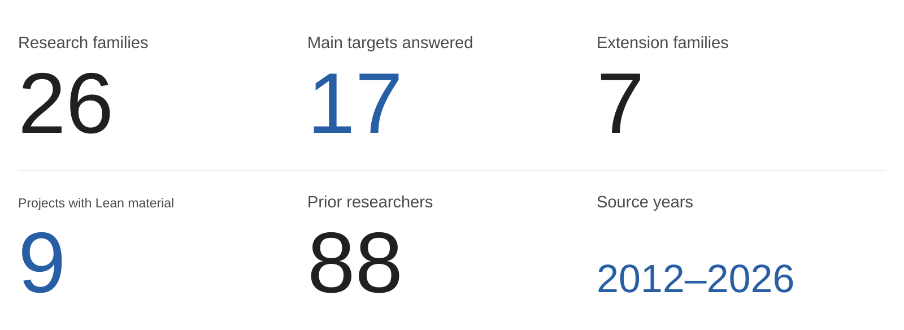

# Aurantium · Mathematics

**Mathematical research · Proofs, counterexamples and extensions**

[中文](README.md) · [English](README.en.md) · [Lean sources](formalizations/README.md) · [Background](REPORT.zh.md) · [References](SOURCES.md)

---

  <picture>
    <source media="(max-width: 650px)" srcset="assets/goethe-epigraph.mobile.svg">
    
  </picture>

A collection of **26 result families** in combinatorics, graph theory, polynomials and asymptotic analysis. Highlights include **a proof of the Katthän’s polynomiality conjecture, exact Catalan–Hankel degree formulas for the Wang–Xin conjecture in Cigler’s formulation, another proof of Karp’s second-order real-rootedness conjecture, and the sharp uniform bound of 23 colours for K₆ chains**.

<picture>
  <source media="(max-width: 650px)" srcset="assets/research-overview.current.mobile.en.svg">
  
</picture>

**Research areas:** extremal graph theory · algebraic combinatorics · commutative algebra · discrete geometry · real-rooted polynomials · enumerative geometry · asymptotic analysis · formalized mathematics

**Methods and tools:** determinants and generating functions · SAGBI bases and toric degeneration · root interlacing and positivity · exact certificates · Lean 4 / mathlib · Python / SymPy · C++17

[Conjecture names, original sources and results](CONJECTURES.md) · [The 88 researchers and their work](PRIOR_RESEARCH.md) · [Statistical definitions](METHODS.md)

## This update · 22 October 2026

- **[Zudilin’s B-polynomial root-location problem](https://github.com/Aurantium-47/zudilin-b-polynomial-real-rootedness)**: posed in 2015, restated in SIGMA (2016), and published in a Springer proceedings volume (2020). The proof covers every real a and n≥2, with nonpositive roots in x=t³ and strict negative-root/interlacing conclusions away from exceptional parameters. The Lean companion is partial, not a full certification.
- **[Orthogonal partial-sum threshold counterexample](https://github.com/Aurantium-47/orthogonal-partial-sum-threshold-counterexample)**: refutes Koelink–Román–Zudilin’s Conjecture 3.4 in arXiv:2409.00261v2. A cubic from an infinite positive orthogonal system has three real roots at t=1/3 but a nonreal pair at t=1/2, with a stronger 1,3,1,3 reentrance certificate. The journal record is Indagationes Mathematicae (2025); identical wording in the inaccessible journal final text has not been verified.
- **[Clique-join unimodality for every blade list](https://github.com/Aurantium-47/clique-join-domination-polynomials)**: completes the unimodality part of Rather’s JCMCC (2025) question. All positive core and blade orders are covered, analytically for N≥23 and by 14,464 exact tuples for N≤22. Earlier two-/three-blade results and the four-blade strengthening remain one group; zero-location questions are not claimed solved.

These ordinary proofs passed independent AI mathematical review, not human peer review or full Lean certification. Two newly public repositories bring the catalog to 26 groups; the clique upgrade adds no group. The 17 main-target answers are not 17 conjectures newly resolved in this update, and the clique entry counts the completed unimodality subquestion only.

## Selected results

| Original target | Previous work | Result presented here |
| --- | --- | --- |
| **Katthän’s polynomiality conjecture** Lecture Hall polynomials · Katthän · 2018 | Computations through length 12 | **Polynomiality at every index**, followed by coefficient formulas and algebraic-structure theorems |
| **Karp’s second-order real-rootedness conjecture** Proposed in 2012 · another proof in 2026 | A 2012 conjecture on real-rootedness; a proof was submitted in October 2026 | **A different proof via Gauss–Lucas convolution, Bernstein polynomials and Beta moments**, for the positive, full-support second-order target; [proof and comparison](KARP_COMPARISON.md) |
| **Wang–Xin degree conjecture** Catalan-power Hankel determinants · Wang–Xin 2018 preprint / 2019 journal; Cigler’s 2023 formulation | Several finite parameter specializations were known | **Exact degrees throughout the full stated two-parameter range**, for j≥1 and k≥2j−1 at the specified offsets |
| **K₆-chain packing-colouring conjecture** Furmańczyk et al. · 2025 | A proposed uniform 22-colour bound | **A 450-vertex counterexample and sharp bound 23**, with equality for long chains |
| **Howroyd’s conjecture** 2018 | One of three classes modulo three was settled | **The other two classes and a full classification of the 27-set branches** |
| **Irregularity extremizers in chemical graphs** Knor et al. · 2024 | Later work covered one class modulo four | **All four classes for every n≥7**, with realizability |
| **Peak last-real-root conjecture** Billey–Fahrbach–Talmage · 2016 journal edition | Partial interval and coefficient results | **The remaining sign interval** for the specified last-real-root conclusion |
| **Orbit-average conjecture for fence rowmotion** Elizalde et al. · clause (b) | A conjectured invariant orbit average | **A 237-step counterexample orbit**, kernel-checked in Lean |

## Extensions

| Project | Beyond the initial target |
| --- | --- |
| [Lecture Hall](https://github.com/Aurantium-47/lecture-hall-polynomiality) | **All-index polynomiality plus structural results:** coefficient formulas, monomial counts, a SAGBI basis and toric degeneration |
| [K6 clique chains](https://github.com/Aurantium-47/k6-clique-chain-packing-coloring) | **One counterexample to a sharp family-wide bound:** exclusion of 22 colours, a uniform 23-colour construction and equality for long chains |
| [q-rook unimodality](https://github.com/Aurantium-47/rook-polynomial-unimodality) | **A particular board problem to arbitrary dimension:** nested-box product differences and related algebraic consequences |
| [Numerical semigroups](https://github.com/Aurantium-47/numerical-semigroup-endpoint-residues) | **Eventual behaviour to explicit formulas:** slopes, correction terms, effective thresholds and signed dilations |
| [Hurwitz polynomials](https://github.com/Aurantium-47/hurwitz-single-cycle-genera-two-three) | **Genus two to genera three and four**, followed by refined asymptotic expansions, root corrections and effective bounds |
| [Infinite log-concavity](https://github.com/Aurantium-47/eventual-infinite-log-concavity) | **Trinomials to general strictly positive polynomials:** a sufficiently-high-power theorem and growing-depth refinements |
| [Narayana lattice sums](https://github.com/Aurantium-47/narayana-polytope-counterexamples) | **Two counterexamples to a general criterion:** a sufficient condition covering a broader class of objects |

## Sources and artifacts

Original questions and related studies appear in Applied Mathematics and Computation, Experimental Mathematics, Journal of Graph Theory, Algebraic Combinatorics, Canadian Journal of Mathematics and other research venues. The [bibliography](SOURCES.md) records 69 source and related-work entries.

The [Lean collection](formalizations/README.md) contains 189 source files from eight fixed public versions. The separate [Zudilin partial companion](https://github.com/Aurantium-47/zudilin-b-polynomial-real-rootedness/tree/main/partial-formalization) adds seven source files, making nine projects with Lean material, not nine fully formalized main theorems. Each repository states its precise proof scope.

## All projects

<strong>All 26 projects</strong>

| Repository | Status |
| --- | --- |
| [howroyd-27-conjecture](https://github.com/Aurantium-47/howroyd-27-conjecture) | Includes Lean results |
| [chemical-graph-sigma-extremizers](https://github.com/Aurantium-47/chemical-graph-sigma-extremizers) | Includes Lean results |
| [stern-polynomial-positivity](https://github.com/Aurantium-47/stern-polynomial-positivity) | Includes Lean results |
| [hardinian-array-asymptotics](https://github.com/Aurantium-47/hardinian-array-asymptotics) | Includes Lean results |
| [triangle-free-circulant-existence](https://github.com/Aurantium-47/triangle-free-circulant-existence) | Includes Lean results |
| [nonmixed-five-point-packing](https://github.com/Aurantium-47/nonmixed-five-point-packing) | Includes Lean results |
| [lecture-hall-polynomiality](https://github.com/Aurantium-47/lecture-hall-polynomiality) | Includes Lean results |
| [fence-rowmotion-counterexample](https://github.com/Aurantium-47/fence-rowmotion-counterexample) | Includes Lean results |
| [k6-clique-chain-packing-coloring](https://github.com/Aurantium-47/k6-clique-chain-packing-coloring) | Written proof / exact verification |
| [rook-polynomial-unimodality](https://github.com/Aurantium-47/rook-polynomial-unimodality) | Written proof / exact verification |
| [even-catalan-hankel-degrees](https://github.com/Aurantium-47/even-catalan-hankel-degrees) | Written proof / exact verification |
| [numerical-semigroup-endpoint-residues](https://github.com/Aurantium-47/numerical-semigroup-endpoint-residues) | Written proof / exact verification |
| [peak-polynomial-last-real-root](https://github.com/Aurantium-47/peak-polynomial-last-real-root) | Written proof / exact verification |
| [karp-order-two-real-rootedness](https://github.com/Aurantium-47/karp-order-two-real-rootedness) | Alternative proof route; comparison with the earlier submission documented |
| [gap-five-gaussian-quotients](https://github.com/Aurantium-47/gap-five-gaussian-quotients) | Written proof / exact verification |
| [hurwitz-single-cycle-genera-two-three](https://github.com/Aurantium-47/hurwitz-single-cycle-genera-two-three) | Written proof / exact verification |
| [eventual-infinite-log-concavity](https://github.com/Aurantium-47/eventual-infinite-log-concavity) | Written proof / exact verification |
| [stanton-eleven-entry-w-positivity](https://github.com/Aurantium-47/stanton-eleven-entry-w-positivity) | Written proof / exact verification |
| [unit-translation-coefficient-oscillation](https://github.com/Aurantium-47/unit-translation-coefficient-oscillation) | Written proof / exact verification |
| [hoggatt-row-sum-moments](https://github.com/Aurantium-47/hoggatt-row-sum-moments) | Written proof / exact verification |
| [narayana-polytope-counterexamples](https://github.com/Aurantium-47/narayana-polytope-counterexamples) | Written proof / exact verification |
| [peak-and-x-descent-growth-rates](https://github.com/Aurantium-47/peak-and-x-descent-growth-rates) | Written proof / exact verification |
| [fixed-length-fertility-counterexample](https://github.com/Aurantium-47/fixed-length-fertility-counterexample) | Written proof / exact verification |
| [clique-join-domination-polynomials](https://github.com/Aurantium-47/clique-join-domination-polynomials) | All-blade computer-assisted unimodality proof; no Lean |
| [zudilin-b-polynomial-real-rootedness](https://github.com/Aurantium-47/zudilin-b-polynomial-real-rootedness) | Complete ordinary proof; partial Lean companion only |
| [orthogonal-partial-sum-threshold-counterexample](https://github.com/Aurantium-47/orthogonal-partial-sum-threshold-counterexample) | Complete ordinary proof and exact rational certificates |

<strong>Research background and mathematical details</strong>

## Selected problems

### Howroyd’s 27-set classification · posed in 2018

[OEIS A297557](https://oeis.org/A297557) records Howroyd’s conjecture dated 1 January 2018. Machacek proved the divisible-by-three branch in work published in the LAGOS 2021 proceedings, Procedia Computer Science 195. This project completes the remaining residue classes and classifies all maximum independent sets: three background classes, each with nine corner extensions, explain the number 27. The remaining-branch theorem is formalized in Lean.

[Proof and classification](https://github.com/Aurantium-47/howroyd-27-conjecture)

### Lecture Hall polynomiality · posed in 2018

[Katthän’s paper](https://arxiv.org/abs/1809.01377), associated with the Osaka lattice-polytopes workshop, proposed polynomiality and algebraic-structure conjectures and reported computations through length 12. This project identifies the sequence with signed Dyck-path sums and proves polynomiality for every index. Further written results construct a minimal monic SAGBI basis, identify its leading exponents with a Hilbert basis, and give a flat toric degeneration. The polynomiality and path-identification core is formalized in Lean. Flajolet’s continued-fraction theory and Sokal’s exposition supply credited classical tools.

[Proof and algebraic extensions](https://github.com/Aurantium-47/lecture-hall-polynomiality)

### Chemical-graph extremizers · a 2024 conjecture

Knor, Škrekovski, Filipovski and Dimitrov posed Conjecture 10 in Applied Mathematics and Computation. Later work in Discrete Mathematics Letters covered the divisible-by-four case. This project classifies the maximizing degree multiplicities for every n ≥ 7, covers all four residue classes, proves connected realizability, and formalizes the original target in Lean.

[All-parameter classification](https://github.com/Aurantium-47/chemical-graph-sigma-extremizers)

### Peak polynomials · Experimental Mathematics, 2016

Billey, Fahrbach and Talmage’s root conjecture belongs to a line of work including the 2017 JCTA positivity theorem and Li’s 2026 coefficient results. The project gives an integral sign argument on the entire interval between the last two peaks. Its additional analysis addresses the remaining noninteger portion; already-known positivity consequences are credited to their sources.

[Root exclusion and sign analysis](https://github.com/Aurantium-47/peak-polynomial-last-real-root)

### Fence rowmotion · Algebraic Combinatorics, 2023

Elizalde, Plante, Roby and Sagan studied orbit statistics on fence posets. A 237-step orbit on 32 elements has cardinality sum 3774 and mean 1258/79 rather than 16, refuting Conjecture 5.4(b). The complete certificate and least-period statement are kernel-checked in Lean.

[Counterexample and certificate](https://github.com/Aurantium-47/fence-rowmotion-counterexample)

### K6 clique chains · a 2025 conjecture

Furmańczyk, Gözüpek and Özkan proposed a uniform 22-colour packing bound. The 450-vertex graph H75 rules out 22 colours; a periodic construction gives a sharp uniform bound of 23. The negative rank certificate contains 16,646,562 records and has Python/C++ checking implementations.

[Sharp bound and exact certificate](https://github.com/Aurantium-47/k6-clique-chain-packing-coloring)

## Mathematical areas

Algebraic combinatorics; extremal graph theory; commutative algebra; discrete geometry; real-rooted polynomials and interlacing; enumerative geometry; asymptotic analysis; dynamical algebraic combinatorics.

Concrete methods include Dyck paths, Stieltjes–Rogers polynomials, Toeplitz/Hankel determinants, SAGBI and Hilbert bases, toric degeneration, Pólya-frequency sequences, monotone Hurwitz numbers, and finite-state rank certificates. Computational tools include Lean 4 / mathlib, Python / SymPy, C++17, and LaTeX, as used in the linked projects.

## Literature and extensions

The bibliography contains 26 problem-source records and 43 related studies or classical tools, covering more than one hundred listed author names. Seven project-level extension groups are highlighted. Karp is included among the affirmative results: our manuscript gives a different proof through Beta moments, Bernstein polynomials and Gauss–Lucas convolution. Zweiman submitted a proof of the same positive second-order target earlier in October 2026; the chronology and the relation between the routes are documented in [the comparison](KARP_COMPARISON.md).

Problem dates and venue information are given in the [research background](REPORT.zh.md). Source dates describe the documented history; each project's exact contribution is stated separately.

## Collaboration

The Hardinian kernel-polynomial integration and related algebraic verification are complete; collaborative generalizations will be added when ready. I lead problem selection, research organization, assessment and delivery, with AI assistance in derivation, implementation and verification. Sources and collaborators receive credit for their actual contributions.
