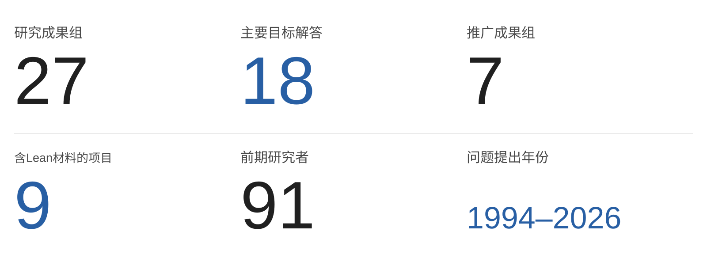

# Aurantium · Mathematics

**数学研究成果 · 证明、反例与推广**

[中文](README.md) · [English](README.en.md) · [Lean源码](formalizations/README.md) · [论文背景](REPORT.zh.md) · [参考文献](SOURCES.md)

---

  <picture>
    <source media="(max-width: 650px)" srcset="assets/goethe-epigraph.mobile.svg">
    
  </picture>

组合数学、图论、多项式与渐近分析的研究成果集，收录**27组成果**。代表结果包括**Katthän多项式性猜想的证明、Wang–Xin次数猜想的精确公式、Karp二阶实根猜想的另一条证明，以及K₆链装填着色的23色锐界**。

<picture>
  <source media="(max-width: 650px)" srcset="assets/research-overview.current.mobile.zh.svg">
  
</picture>

**涉及领域：** 极值图论 · 代数组合 · 交换代数 · 离散几何 · 实根多项式 · 枚举几何 · 渐近分析 · 形式化数学

**方法与工具：** 行列式与生成函数 · SAGBI基与toric退化 · 根交错与正性 · 精确证书 · Lean 4 / mathlib · Python / SymPy · C++17

[猜想名称、原始出处与本研究结论](CONJECTURES.md) · [91位研究者及其工作](PRIOR_RESEARCH.md) · [统计说明](METHODS.md)

## 新公开部分结果 · 2026年11月4日

**[Kubitzke–Welker 问题 4.4：覆盖全部 1–13 次情形](https://github.com/Aurantium-47/kubitzke-welker-degree13/tree/11e7139f991497229885d2f1b096949c77265e92)** · [原问题，第 17 页](https://www.mathematik.uni-marburg.de/~welker/preprints/Veronese.pdf#page=17) · 实根多项式 / 单纯复形

**系数大小不设上限。** 对任意仅有实零点、系数为正整数的 h(t)=1+h₁t+⋯+h_dtᵈ，只要 1 ≤ d ≤ 13，每个严格递增初段 1 < h₁ < ⋯ < hᵣ 的差分向量 (1,h₁−1,…,hᵣ−hᵣ₋₁) 都是某个单纯复形的 f 向量。

**证明与范围：** 严格的计算机辅助证明结合穷尽的精确整数枚举与覆盖整个无界尾部的解析论证。**不限制次数的一般问题在本工作中仍未解决。**

**审核与优先权：** AI 生成的数学工作经两组独立开展的 AI 审核，有限计算有三套实现。**尚无人类同行评审或证明助手形式化，创新性与发表优先权未确立。** [来源与声明边界](https://github.com/Aurantium-47/kubitzke-welker-degree13/blob/11e7139f991497229885d2f1b096949c77265e92/PROVENANCE.md)

范围示意、证明与精确证书

- **证明：** [12 次以内的论证](https://github.com/Aurantium-47/kubitzke-welker-degree13/blob/11e7139f991497229885d2f1b096949c77265e92/proofs/degree12_proof.md)与 [13 次扩展](https://github.com/Aurantium-47/kubitzke-welker-degree13/blob/11e7139f991497229885d2f1b096949c77265e92/proofs/degree13_extension.md)得到初始差分的 Kruskal–Katona 结论，不只是 Macaulay 增长，也不是另外的原系数向量问题。
- **[复现材料](https://github.com/Aurantium-47/kubitzke-welker-degree13/blob/11e7139f991497229885d2f1b096949c77265e92/REPRODUCIBILITY.md)：** 66 个指标情形共枚举 10,445,449 个有限 q 值，余下 15 个局部候选元组均由精确代数论证排除；无界尾部已有证明，不是截断搜索。
- **边界：** 单独使用 Newton 不等式可保证到 11 次，12 次有反例；该反例不是实根多项式，因此不反驳原问题 4.4。[原始来源与相近问题区别](https://github.com/Aurantium-47/kubitzke-welker-degree13/blob/11e7139f991497229885d2f1b096949c77265e92/SOURCES.md)

**目录边界：** 本部分结果单独列出，不并入保持原样的11月2日27项目核心目录快照；本次不更新项目、已解目标或Lean统计。

## 新公开证明候选稿 · 2026年11月4日

**[Ferroni–McGinnis 单位圆猜想 · 证明候选稿](https://github.com/Aurantium-47/ferroni-mcginnis-unit-circle/tree/d9b2bc10e2c8efef8765542f099ea9432ac45de9)** · [猜想 4.5](https://arxiv.org/html/2202.11808v2#S4.SS2) · 多项式零点

**任意正整数容量向量 → 全部零点落在 |x| = 1 上。** 解析证明稿覆盖所有 n ≥ 1、1 ≤ k ≤ n 的加权排列多项式，包括不等容量；常数多项式没有零点。

**审核与优先权：** 两次独立开展的 AI 审核均未发现数学缺口；目前仍为**未经人类同行评审、未完成形式化验证的证明候选稿**。2026 年 9 月的一条 MathOverflow 评论链接了可能相关的更早解答，但其内容未能读取。**创新性与优先权尚未确定，不作首创声明。** [审核状态](https://github.com/Aurantium-47/ferroni-mcginnis-unit-circle/blob/d9b2bc10e2c8efef8765542f099ea9432ac45de9/docs/REVIEW_STATUS.md) · [来源与更早解答线索](https://github.com/Aurantium-47/ferroni-mcginnis-unit-circle/blob/d9b2bc10e2c8efef8765542f099ea9432ac45de9/docs/SOURCES.md)

证明路线图与可复现检验

- **[证明路线](https://github.com/Aurantium-47/ferroni-mcginnis-unit-circle/blob/d9b2bc10e2c8efef8765542f099ea9432ac45de9/docs/PROOF.md)：** 路径矩阵行列式与 Gauss–Lucas 定理将变换后的零点限制在 (−2,2)，再由经典 Grace–Walsh–Szegő 定理与倒数对称性推广到任意正整数容量。递推、生成函数及经典工具均明确归属前人。
- **[计算检验](https://github.com/Aurantium-47/ferroni-mcginnis-unit-circle/blob/d9b2bc10e2c8efef8765542f099ea9432ac45de9/docs/VERIFICATION.md)：** 附 404 个精确单位圆认证；有限检验与图中算例不代替全参数解析证明。本项目只涉及猜想 4.5，不解决另外的 h* 实根性或交错性猜想。

**目录边界：** 本候选稿单独列出，不并入保持原样的11月2日27项目核心目录快照；本次不更新项目、已解目标或Lean统计。

## 新增公开入口 · 2026年11月3日

**正式问题集 · 两项完整否定答案，现已公开源码与复核材料**

- **[AIM 23 / Craven–Csordas（2004）](https://github.com/Aurantium-47/aim23-czds-counterexample/tree/491fc358e101f0028af7ab01e9835c5d8d8218e0)：非实根 4 → 6。** 构造满足原题全部假设的整函数与系数序列，但逐系数变换反而增加非实根，否定原充分性问题；不是仅验证有限参数。
- **[AIM 34（2007）](https://github.com/Aurantium-47/aim34-multiplier-sequence/tree/797fe1cb3d5386acd70f5cdd0ec5ce40c5c79a4e)：所有实数 m > 0，都不成立。** 序列 (n+m)^(√(n+m)) 对每个正实平移均不保持多项式实根性，完整否定“充分大的整数平移能否成立”的问题。

直观示意、Lean验证范围与公开版本

两项完整原始靶标已有 **2026年10月的Lean源码重放与独立AI辅助语义复核记录**；此次公开归档与展示没有重新编译Lean。AIM23的精确4→6来自独立有理/Sturm证书，Lean证明输入至多4、输出恰为6；AIM34证明每个参数存在有限多项式反例，不给统一次数上界。原题来自书章／AIM问题表，**不是四大期刊出处**；不宣称人工同行评审、期刊接受或全球首解。固定仓库版本保留源码、历史证据、复现说明及原题链接失效说明。

**统计边界：** 上方看板与下方27项目表保留11月2日核心目录快照；这里链接的AIM23、AIM34是此前已完成、此次新增公开仓库的两项成果，尚未并入该快照的项目／Lean统计。公开归档不是新增证明，不将不同证明、证书或复核重复计数。

## 本次更新 · 2026年11月2日

**三项式无限对数凹性：所有n≥10，所有迭代层。** [固定版本计算机辅助证明草稿68f4c920](https://github.com/Aurantium-47/eventual-infinite-log-concavity/tree/68f4c920606ad239fbc3a8195bc0987b790f5905/research/trinomial-all-n-ge10)完成[Medina–Straub（2014）例5.3](https://arxiv.org/pdf/1405.1765v1#page=11)的特定断言：对每个整数n≥10，(1+x+x²)^n的系数序列在支撑之外补零后，每一层对数凹迭代均非负。进一步，对每个n≥4004，第四层迭代多项式有**2n个互异负实根**。解析论证与精确证书共同覆盖完整无界命题，并非有限实验外推。已完成[独立AI辅助数学与计算复核](https://github.com/Aurantium-47/eventual-infinite-log-concavity/blob/1f9c5ce4cd6c5b2e0fe908f11f0a51d85648591f/research/trinomial-all-n-ge10/review-2026-11-02/REVIEW.md)，包括边界包络从头重建。[研究草稿PR #2](https://github.com/Aurantium-47/eventual-infinite-log-concavity/pull/2)仍未合并；不宣称人工同行评审、形式化验证或历史首创认证。本结果不证明一般猜想5.2。统计保持**27组、18项主要目标解答**（14项肯定、4项反例）、6项部分解答、3项构造／分类；7组推广和9个含Lean材料项目不变。

**[BRW τ实性团粘合：统一圈替换与结构类](https://github.com/Aurantium-47/brw-tau-clique-attachments)**。将任意普通τ实图替换到任意圈C_(m+2)的一个顶点（所有m≥1），所得图仍为普通τ实图，且Bell边商只有非正实根，因此可与任意普通τ实图沿边粘合，操作可迭代。[统一已发布证明版本](https://github.com/Aurantium-47/brw-tau-clique-attachments/tree/dc6d35ba53c6a41064bc9982cb524b05b74dc2ff/extensions/2026-11-02-uniform-cycle-substitution)。根的单调性与扩充箭头矩阵不变量给出覆盖所有圈长及输入次数的普通数学证明，不依赖有限算例外推；具有互异严格负实根的输入给出严格交错，非零边界输入给出弱交错。不宣称任意同时图替换或不受限的大团粘合。

统一定理包含此前C₅/C₇替换及Θ(2ᵏ,m)特例（2ᵏ表示k条长度为2的路径），并不替代独立的[全三路径定理](https://github.com/Aurantium-47/brw-tau-clique-attachments/tree/cfa1f5fd798116b44ddc95da6f90710e48fac14a/extensions/2026-11-02-all-theta)：全部a,b,c≥2的Θ(a,b,c)有严格负实根Bell边商；也不替代[任意路径数的充分长条件](https://github.com/Aurantium-47/brw-tau-clique-attachments/tree/b40ae7bc9df78ab78d47470d26c1915a0208182f/extensions/2026-11-02-parallel-paths)。带锚点不可比图的团商定理仍保留。给实根Bell边商的种子H添加通用团K_s，可覆盖团商阶数0≤j≤s+2；仅当H无三角形时覆盖全部可能团交。

BRW仍计为**一个部分结果组**；目录保持27组、18项主要目标解答（14项肯定结论与4项反例）、6组部分解答、3组构造与分类、7组推广及9个含Lean材料项目。一般BRW猜想6.5未解决，猜想6.6是不同的图联接问题。统一证明经过独立AI内部复核，不是人工同行评审或证明助手形式化；全三路径定理保留其计算机辅助证明与精确证书。文献比较尚不完整，Mu–Shen–Xu全文未取得、精确重叠待核，不宣称历史首创或全球开放状态。

## 上次更新 · 2026年10月22日

- **[Zudilin B多项式实根性](https://github.com/Aurantium-47/zudilin-b-polynomial-real-rootedness)**：2015年提出的全实参数观察，2016年SIGMA问题报告重述，2020年收入Springer论文集。证明所有实参数a、n≥2时Pₙᵃ(x)的零点非正，并给出非例外参数的严格负根、交错和定位。变量为x=t³；仅有部分Lean伴随，完整形式化未完成。
- **[正交部分和阈值反例](https://github.com/Aurantium-47/orthogonal-partial-sum-threshold-counterexample)**：否定Koelink–Román–Zudilin于2024年提出、arXiv v2猜想3.4的单阈值断言。无限正交系统中的三次部分和，在t=1/3有三个实根、t=1/2却有非实根；进一步给出1、3、1、3的再入根数。期刊为Indagationes Mathematicae（2025），但最终全文与v2是否同文未核对，不扩大反驳对象。
- **[Clique-join全叶片单峰性](https://github.com/Aurantium-47/clique-join-domination-polynomials)**：完成Rather在JCMCC（2025）问题中的单峰性部分。任意正核心、叶片数及大小均覆盖；N≥23解析证明，N≤22精确穷尽14,464组参数。四叶片更强结论与旧的两／三叶片结果保留在同一组，不重复计数；零点问题不宣称解决。

以上普通证明均经独立AI数学复核，不等于人工同行评审或完整Lean认证。当时新增两个已公开项目使总数成为26组；全叶片升级不增加组数。当时17项主要目标解答不是17个该次新解猜想，其中clique-join只计已完整解决的单峰性子问题。

## 代表结果

| 原题 | 已有研究 | 本研究的结果 |
| --- | --- | --- |
| **三项式无限对数凹性** Medina–Straub · 2014 · 例5.3 | 原文已证明10≤n≤500 | **每个整数n≥10、每一层迭代**；n≥4004时第四层有2n个互异负实根；[计算机辅助证明草稿](https://github.com/Aurantium-47/eventual-infinite-log-concavity/tree/68f4c920606ad239fbc3a8195bc0987b790f5905/research/trinomial-all-n-ge10) |
| **Katthän多项式性猜想** Lecture Hall多项式 · Katthän · 2018 | 原文计算验证到长度12 | **证明任意长度成立**；进一步得到系数公式和代数结构定理 |
| **Karp二阶实根猜想** 2012年提出 · 2026年给出另一条证明 | 原题于2012年提出；2026年10月已有先行提交的证明 | **通过Gauss–Lucas卷积、Bernstein多项式与Beta矩给出不同路线的证明**，覆盖二阶正满支撑目标；[证明与同期工作](KARP_COMPARISON.md) |
| **Wang–Xin次数猜想** Catalan幂Hankel行列式 · Wang–Xin 2018预印本／2019期刊版；Cigler表述2023 | 文献给出若干有限参数特例 | **覆盖两个参数的完整有效范围**，证明全部j≥1、k≥2j−1的指定余类精确次数公式 |
| **K₆链装填着色猜想** Furmańczyk等 · 2025 | 原文提出统一22色上界 | **450顶点反例＋全家族23色锐界**；长链的精确答案为23 |
| **Howroyd猜想** 2018 | 三个模3余类中的一个已有证明 | **补齐另外两个余类，并完整分类27集分支**；与已知结果合并覆盖三类 |
| **化学图不规则度极值猜想** Knor等 · 2024 | 后续论文覆盖一个模4余类 | **覆盖全部四类、所有n≥7**，同时证明每种极值分布都可实现 |
| **Peak末实根猜想** Billey–Fahrbach–Talmage · 2016期刊版 | 部分区间和系数性质已有结果 | **补齐剩余区间的符号论证**，完成指定的最后实根结论 |
| **Fence行运动轨道均值猜想** Elizalde等 · 原断言(b) | 原题预测轨道平均值恒定 | **构造237步完整轨道，否定该条断言**；反例已由Lean内核核验 |

## 推广成果

| 项目 | 原题之外做到了什么 |
| --- | --- |
| [Lecture Hall](https://github.com/Aurantium-47/lecture-hall-polynomiality) | **任意长度的证明＋一组结构定理**：进一步给出系数公式、单项式数量、代数基和退化结构 |
| [K6链着色](https://github.com/Aurantium-47/k6-clique-chain-packing-coloring) | **一个反例→整个家族的正确锐界**：排除22色，再证明所有链都能用23色，长链的精确答案就是23 |
| [q-rook单峰性](https://github.com/Aurantium-47/rook-polynomial-unimodality) | **特定棋盘→任意维度**：推广到嵌套盒乘积差的一般结论，并得到相关代数推论 |
| [数值半群](https://github.com/Aurantium-47/numerical-semigroup-endpoint-residues) | **存在规律→明确公式与有效界**：算出斜率、修正项和成立范围，并覆盖正负伸缩 |
| [Hurwitz多项式](https://github.com/Aurantium-47/hurwitz-single-cycle-genera-two-three) | **从g=2扩展到g=3、4**，继续得到更一般情形的精细展开、根修正与定量界 |
| [无限对数凹性](https://github.com/Aurantium-47/eventual-infinite-log-concavity/tree/68f4c920606ad239fbc3a8195bc0987b790f5905/research/trinomial-all-n-ge10) | **三项式原始目标及同组推广**：全部整数n≥10见上方固定公开草稿；一般正系数充分大幂与增长深度细化保留 |
| [Narayana格点和](https://github.com/Aurantium-47/narayana-polytope-counterexamples) | **两个反例→一般判据**：从否定实例进一步提炼出适用于更广对象的统一充分条件 |

## 论文出处

原题及相关研究见于 **Applied Mathematics and Computation、Experimental Mathematics、Journal of Graph Theory、Algebraic Combinatorics、Canadian Journal of Mathematics、Journal of Pure and Applied Algebra** 等专业期刊，以及LAGOS会议论文集、OEIS和研究预印本。

例如，Howroyd问题有2018年的明确提问和Machacek的部分证明；Lecture Hall来自Katthän的2018年论文；Peak项目对应2016年正式发表论文中的具体猜想。目录整理了**70条问题来源与相关文献**，每项成果均链接原题和前人工作。

## 论文与代码

- **[27个项目](#全部项目)**：具体命题、证明与项目说明。
- **[8个项目、189个Lean源文件的固定归档](formalizations/README.md)**；另有[Zudilin部分伴随](https://github.com/Aurantium-47/zudilin-b-polynomial-real-rootedness/tree/main/partial-formalization)的7个Lean源文件。合计9个含Lean材料的项目，不代表9个全定理完成形式化。
- **[证明与验证材料](METHODS.md)**：原题与文献对照、证明检查、精确计算或有限证书核验。
- **[参考文献](SOURCES.md)**：原论文、相关研究及各自的关系。

## 全部项目

<strong>展开全部27个项目</strong>

| 项目 | 已形成的结果 | 验证与文献状态 |
| --- | --- | --- |
| [Howroyd 27集分类](https://github.com/Aurantium-47/howroyd-27-conjecture) | 证明剩余两个模3余类均恰有27个最大独立集，并给出分类 | Lean |
| [化学图极值度数分类](https://github.com/Aurantium-47/chemical-graph-sigma-extremizers) | 对所有n≥7完成Conjecture 10的极值度数重数分类与可实现性 | Lean |
| [Ulas无实根猜想](https://github.com/Aurantium-47/stern-polynomial-positivity) | 全参数正性；另以B183否定单调性条款 | Lean |
| [Hardinian数组渐近](https://github.com/Aurantium-47/hardinian-array-asymptotics) | r=2、3渐近式；r=2及高阶核展开已形式化，全r衔接暂存 | Lean子结果 |
| [无三角形循环图存在性](https://github.com/Aurantium-47/triangle-free-circulant-existence) | 覆盖每个k≥1及6k+2≤n≤8k的全部偶数n，给出明确构造 | Lean |
| [五点集合装填密度](https://github.com/Aurantium-47/nonmixed-five-point-packing) | k=m=2、任意互素正参数及非周期中心集的精确密度 | Lean；后续云日志验收悬项 |
| [Katthän多项式性猜想](https://github.com/Aurantium-47/lecture-hall-polynomiality) | 全下标多项式性、signed Dyck识别；SAGBI基与平坦退化扩展 | Lean核心 |
| [Fence行运动反例](https://github.com/Aurantium-47/fence-rowmotion-counterexample) | 32元素fence上237态完整轨道，均值1258/79，否定5.4(b) | Lean |
| [K6链装填着色](https://github.com/Aurantium-47/k6-clique-chain-packing-coloring) | H75否定22色上界；所有链统一23色，t≥75达到23 | 精确证书 |
| [q-rook与嵌套盒单峰性](https://github.com/Aurantium-47/rook-polynomial-unimodality) | 所有非空Ferrers板near-full q-rook多项式单峰 | 证明与精确核查 |
| [Wang–Xin次数猜想](https://github.com/Aurantium-47/even-catalan-hankel-degrees) | 所有j≥1、k≥2j−1的两个指定余类，精确次数(2j−1)(k−j) | 证明与精确核查 |
| [数值半群端点残差](https://github.com/Aurantium-47/numerical-semigroup-endpoint-residues) | 平移族最终仿射；显式斜率、修正项与有效阈值 | 证明与精确核查 |
| [Peak末实根猜想](https://github.com/Aurantium-47/peak-polynomial-last-real-root) | 对任意可容许峰集，完成倒数第二峰之后整个实区间的符号与最后实根结论 | 证明与精确核查 |
| [Karp二阶变换实根性](https://github.com/Aurantium-47/karp-order-two-real-rootedness) | 正、满支撑的二阶Pochhammer变换负实根性及残余根间距 | 不同证明路线；与先行成果的比较见专页 |
| [Gap-five Gaussian商正性](https://github.com/Aurantium-47/gap-five-gaussian-quotients) | gap=5、k≥8、n≥2k：多项式性蕴含系数非负；与已知边界合并覆盖k≥5 | 证明与符号证书 |
| [Hurwitz多项式与大亏格展开](https://github.com/Aurantium-47/hurwitz-single-cycle-genera-two-three) | g=2、3、4单周期全次数实根/交错；一般profile有效大亏格精细项 | 证明与精确核查 |
| [最终无限对数凹性](https://github.com/Aurantium-47/eventual-infinite-log-concavity/tree/68f4c920606ad239fbc3a8195bc0987b790f5905/research/trinomial-all-n-ge10) | 三项式(1+x+x²)^n对所有整数n≥10、全部零延拓对数凹迭代非负；公开复核草稿覆盖原始目标 | 计算机辅助证明与精确证书；独立AI内部复核；PR #2草稿未合并，非人工同行评审或Lean |
| [Stanton十一项W正性](https://github.com/Aurantium-47/stanton-eleven-entry-w-positivity) | 对所有可容许对称11项向量证明W正性，A无上界 | 证明与精确证书 |
| [单位平移后的无界振荡](https://github.com/Aurantium-47/unit-translation-coefficient-oscillation) | 显式递归构造：正非增整数系数经x→x+1后可出现任意多次相邻差符号变化 | 构造证明 |
| [Hoggatt行和矩分类](https://github.com/Aurantium-47/hoggatt-row-sum-moments) | 数值行和的Stieltjes矩分类、显式测度及行列式证书；保留Baxter既有结论归属 | 证明与精确证书 |
| [Narayana格点和](https://github.com/Aurantium-47/narayana-polytope-counterexamples) | 两个多面体反例及普遍excess≤3实根性充分条件 | 证明与精确证书 |
| [Peak与X-descent增长率谱](https://github.com/Aurantium-47/peak-and-x-descent-growth-rates) | 构造实现峰集增长率整个区间及可同时选择X/I时的[0,1]谱 | 构造证明 |
| [固定长度fertility反例](https://github.com/Aurantium-47/fixed-length-fertility-counterexample) | 长度9完整枚举362880个排列，fertility谱缺55，否定固定长度包含猜想 | 穷举证书与证明 |
| [Clique-join支配多项式](https://github.com/Aurantium-47/clique-join-domination-polynomials) | 任意正核心及叶片大小的全家族单峰性；保留两叶片ULC及三叶片反例 | 计算机辅助证明；独立AI复核；无Lean |
| [Zudilin B多项式实根性](https://github.com/Aurantium-47/zudilin-b-polynomial-real-rootedness) | 所有实参数a、n≥2，Pₙᵃ(x)非正实根；非例外参数严格交错 | 完整文字证明；仅部分Lean |
| [正交部分和阈值反例](https://github.com/Aurantium-47/orthogonal-partial-sum-threshold-counterexample) | 三次部分和反驳arXiv v2猜想3.4；根数出现1、3、1、3再入 | 完整文字证明；精确Sturm证书 |
| [BRW τ实性团粘合](https://github.com/Aurantium-47/brw-tau-clique-attachments) | 统一圈替换；带锚点不可比图；全三路径图族，猜想6.5部分结果 | 统一普通数学证明；theta另附精确证书；无Lean |

<strong>研究背景与数学细节</strong>

## 重点成果及其研究沿革

### 01 · Howroyd：为什么最大独立集恰好有27个？

**2018年提出 · 2021年出现部分证明 · 图论与代数组合 · Lean形式化**

Andrew Howroyd于2018年1月1日在[OEIS A297557](https://oeis.org/A297557)提出一个周期现象：三角网格的最大独立集数量，最终反复出现1、27、27。John Machacek随后证明可被3整除的分支具有唯一最大独立集，论文发表于**LAGOS 2021会议论文集，Procedia Computer Science 195**。[前人论文](https://arxiv.org/abs/2010.11112)

本项目补齐另外两个余类，并给出全部最大独立集的结构分类。27来自三个背景色类，每一类对应9种角部延拓：**3 × 9 = 27**。因此，计算中出现的规律有了对所有允许参数成立的解释。相应27集定理已完成Lean形式化。

→ [证明、分类与精确证书](https://github.com/Aurantium-47/howroyd-27-conjecture)

### 02 · Lecture Hall：从2018年的多项式猜想到代数结构

**2018年提出 · 原文验证至长度12 · 多项式性、SAGBI基与toric退化**

Lukas Katthän在[The Lecture Hall Cone as a toric deformation](https://arxiv.org/abs/1809.01377)中提出两个相互关联的猜想：递归定义的Laurent多项式是否其实都是多项式，以及相应代数能否解释Lecture Hall锥的结构。原文报告了长度不超过12的计算验证，材料来自**大阪大学2018年格点多面体研讨会**。

本项目把特定递归序列识别为带符号Dyck路径的有限权重和，证明全下标多项式性；进一步给出最小单首SAGBI基、领先指数与Hilbert基的对应，以及到半群代数的平坦退化。核心多项式性和路径识别已有Lean证明，代数推广附有完整文字证明。

这条研究线连接**组合路径、行列式恒等式与交换代数**。原题之外，Flajolet的连分数理论（Discrete Mathematics，1980）与Sokal的系统论述（Expositiones Mathematicae，2023）提供经典工具；三项文献的角色在项目中分别列明。

→ [多项式证明与SAGBI推广](https://github.com/Aurantium-47/lecture-hall-polynomiality)

### 03 · 化学图极值：把一个余类推进到所有规模

**2024年原题 · 4位原作者 · Applied Mathematics and Computation · 全部n ≥ 7**

Knor、Škrekovski、Filipovski与Dimitrov在[Extremizing antiregular graphs by modifying total σ-irregularity](https://doi.org/10.1016/j.amc.2024.129199)中提出Conjecture 10：在最大度数不超过4的连通简单图中，哪些度数重数使指定的全点对不规则度达到最大？2026年[Discrete Mathematics Letters后续论文](https://doi.org/10.47443/dml.2026.041)报告了顶点数可被4整除的情形。

本项目覆盖**所有n ≥ 7的四个模4余类**，同时证明每个候选度数向量都可由连通简单图实现。结果给出完整的极值度数重数分类，包含两个容易遗漏的n ≡ 2分支，并完成原目标的Lean形式化。

→ [全参数分类与形式化证明](https://github.com/Aurantium-47/chemical-graph-sigma-extremizers)

### 04 · Peak多项式：排除一个完整实区间里的根

**2014年预印本 · 2016年期刊版本 · Experimental Mathematics · 实代数与排列枚举**

Billey、Fahrbach与Talmage研究排列的峰集所对应的多项式，其[Coefficients and roots of peak polynomials](https://arxiv.org/abs/1410.8506)发表于**Experimental Mathematics 25(2)，2016**。本项目对应其Conjecture 6.6。后续有Diaz-Lopez、Harris、Insko与Omar的正性论文（**JCTA，2017**），以及Li于2026年的[系数研究稿](https://doi.org/10.5281/zenodo.22832569)。

本项目给出自包含积分论证，控制倒数第二峰a与最后一峰m之间<strong>整个实区间 (a,m)</strong>的符号，得到m是a之后唯一实根，且对峰的数量、位置和间距不设有限上限。与Li结果的比较中，新增分析集中在剩余的非整数区间(a,m−1)，已知右侧正性等结论保留原归属。

→ [完整区间的符号论证](https://github.com/Aurantium-47/peak-polynomial-last-real-root)

### 05 · Fence：一个237步轨道改变命题的真假

**2021年预印本 · 2023年期刊论文 · 4位原作者 · Algebraic Combinatorics**

Elizalde、Plante、Roby与Sagan在[Rowmotion on fences](https://arxiv.org/abs/2108.12443)中研究偏序集上的组合动力系统。Conjecture 5.4(b)预测某类fence的序理想大小，在完整轨道上的平均值固定。

本项目构造32元素fence上的一个237步轨道，大小总和为3774，平均值为**1258/79，而非16**，从而否定该条断言。完整轨道及其最小周期均有证书，并由Lean内核核验。这个例子展示了反例的价值：一个可彻底检查的对象，足以划清一般规律的边界。

→ [反例、完整轨道与Lean证明](https://github.com/Aurantium-47/fence-rowmotion-counterexample)

### 06 · K6链：用精确证书把22改成锐界23

**2025年提出 · 3位原作者 · 图着色与有限状态证书**

Furmańczyk、Gözüpek与Özkan在[Packing coloring of graphs with long paths](https://arxiv.org/abs/2511.12761)中提出统一22色上界。这里同色顶点的距离限制随颜色编号增加，局部可行并不保证整条链可行。

本项目给出450顶点、1199条边的H75，排除22色；再构造统一的23色周期方案，得到所有链的23色上界，并对t ≥ 75证明精确值为23。否定部分由**16,646,562条秩证书记录**支撑，配有Python与C++检查器。

→ [锐界证明与可复核证书](https://github.com/Aurantium-47/k6-clique-chain-packing-coloring)

---

## 数学领域与方法

| 研究领域 | 具体数学内容 | 代表项目 |
| --- | --- | --- |
| 代数组合 · Algebraic combinatorics | Dyck路径、Stieltjes–Rogers多项式、Toeplitz/Hankel行列式、连分数 | Lecture Hall、Catalan、Hoggatt |
| 交换代数与离散几何 | SAGBI基、Hilbert基、半群代数、Ehrhart结构、toric退化 | Lecture Hall、数值半群、q-rook |
| 极值图论与组合优化 | 独立集、循环图、装填着色、度数极值、有限状态秩证书 | Howroyd、化学图、K6链 |
| 实根多项式与正性 | 根交错、Pólya频率序列、系数单峰性、无限对数凹性 | Peak、Hurwitz、q-rook、对数凹性 |
| 枚举几何与渐近分析 | 单调Hurwitz数、换位分解、大亏格展开、根渐近修正 | Hurwitz、Hardinian |
| 代数组合动力系统 | 偏序集、序理想、rowmotion、homomesy | Fence |

**计算与形式化工具：** Lean 4 / mathlib用于形式化证明；Python / SymPy用于精确符号计算；C++17用于大型证书检查；LaTeX用于论文与数学排版。各工具的实际覆盖以对应项目为准。

## 前人研究与论文出处

当前目录整理了**27条问题来源、43条相关研究与工具文献，共70条记录**，覆盖百余个作者署名。下面几条线索能说明这些问题处在怎样的研究积累之中。

| 研究线 | 目录中的前人线索 | 发表载体 |
| --- | --- | --- |
| Howroyd | 原始OEIS提问；Machacek的可被3整除分支 | OEIS；LAGOS 2021 / Procedia Computer Science |
| Lecture Hall | Katthän原题；Flajolet连分数理论；Sokal系统论述 | Osaka研讨会材料；Discrete Mathematics；Expositiones Mathematicae |
| 化学图 | Knor等4位作者的原题；Dimitrov等人的一个模4余类结果 | Applied Mathematics and Computation；Discrete Mathematics Letters |
| Peak多项式 | Billey–Fahrbach–Talmage原题；Diaz-Lopez等4人的正性论文；Li的系数稿 | Experimental Mathematics；JCTA；Zenodo研究稿 |
| Hurwitz | Coulter–Do–Moskovsky原题；Accadia–Lewanski–Ruzza框架；Yang的相关渐近研究 | Canadian Journal of Mathematics；两篇arXiv预印本 |
| 无三角形循环图 | Ayat等原题；Sidorenko、Brandt的构造；Bickle–Cream–Gould的端点结果 | AIMS Mathematics；Discrete Mathematics |

这里既有对同一问题的推进，也有证明所使用的经典工具。逐篇关系、作者和DOI见[文献目录](SOURCES.md)。

原题涉及**Applied Mathematics and Computation、Experimental Mathematics、Journal of Graph Theory、Canadian Journal of Mathematics、Algebraic Combinatorics、Electronic Journal of Combinatorics、Journal of Pure and Applied Algebra**等专业期刊。分区按明确版次列在[研究背景](REPORT.zh.md)，成果本文的发布状态见各项目。

<strong>Karp：另一条证明与同期工作</strong>

**Karp二阶实根猜想的另一条证明。** 本项目采用Beta矩、Bernstein多项式与Gauss–Lucas卷积路线，属于本系列的证明成果。同期Zweiman的arXiv提交比本项目Release早约三天，主目标重合，证明路线不同。附带参数化引理与对称权重推论仍单独作推广对照。[时间线与逐项比较](KARP_COMPARISON.md)

## 合作与后续

Hardinian的实际核多项式及相关代数验证已完成，一般化结果正在合作推进，完成后补充。

本系列由我负责选题、研究组织、结果判断与交付，AI辅助推导、实现和核验。合作成果按实际贡献署名；原论文与工具的归属分别保留在各项目中。

## 原问题出处参考（不代表本仓库成果已获期刊接受）

下表区分原问题的公开年代、明确题号及原论文发表载体。**这些期刊、书章和问题清单是原题出处，不是本研究的发表成绩。** 本研究尚未获任何期刊或会议接受；Lean 验证和独立 AI 复核也不等于人类同行评审或全球首创认证。出处年代和载体提供研究背景，不单独代表问题难度或贡献大小。

| 原问题 | 年代与题号 | 原作者及可核对的正式出处 |
| --- | --- | --- |
| **BRW 图多项式团交叠** | **1994**，Conjecture 6.5，第 76 页 | Francesco Brenti、Gordon F. Royle、David G. Wagner；*Location of Zeros of Chromatic and Related Polynomials of Graphs*，[Canadian Journal of Mathematics **46(1)** (1994), **55–80**](https://www.cambridge.org/core/journals/canadian-journal-of-mathematics/article/location-of-zeros-of-chromatic-and-related-polynomials-of-graphs/8B66867EF89BFB7C22DDD36E718D8157)，[DOI: 10.4153/CJM-1994-002-3](https://doi.org/10.4153/CJM-1994-002-3)。正式期刊论文。 |
| **Craven–Csordas / AIM 23** | **2004** 作者稿 Problem 4.16；**2007** AIM Problem 23 | Thomas Craven、George Csordas；*Composition Theorems, Multiplier Sequences and Complex Zero Decreasing Sequences*，收于 [*Value Distribution Theory and Related Topics*, Advances in Complex Analysis and Its Applications **3** (2004), **131–166**](https://link.springer.com/chapter/10.1007/1-4020-7951-6_6)，Kluwer Academic Publishers，现由 Springer 托管；[作者稿](https://math.hawaii.edu/~tom/mathfiles/czdssurvey.pdf)、[AIM 问题集第 7 页](https://aimath.org/WWN/polyaschurlax/polyaschurlax.pdf)。正式书章与官方问题清单。 |
| **AIM 34 乘子序列** | **2007**，Problem 34，第 9 页 | [AIM “Pólya–Schur–Lax Problems: Hyperbolicity and Stability Preservers” 问题集](https://aimath.org/WWN/polyaschurlax/polyaschurlax.pdf)，编者 Julius Borcea、Petter Brändén、George Csordas、Victor Vinnikov；[研讨会日期：2007-05-28 至 06-01](https://aimath.org/pastworkshops/polyaschurlax.html)。官方研讨会问题清单，**不是同行评审会议论文**；该题未单独署名。 |
| **Sun–Zhao 椭圆积分序列** | **2016-02-13** 预印本；[v1 猜想 5.1、5.2、5.3，第 12 页](https://arxiv.org/pdf/1602.04359v1) | Brian Yi Sun、James Jing-Yu Zhao；*Log-behavior of Two Sequences Related to the Elliptic Integrals*，[Acta Mathematicae Applicatae Sinica, English Series **36(3)** (2020), **590–602**](https://link.springer.com/article/10.1007/s10255-020-0952-1)，DOI: 10.1007/s10255-020-0952-1。正式期刊论文；刊期为 2020 年 7 月，出版社正式版本日期为 2020-09-02。 |
| **Simon 完全单调性** | **2020-12-20** 预印本；[v2 §3 第 5 页无编号主猜想及随后阈值凸性提问](https://arxiv.org/pdf/2012.11018v2) | Thomas Simon；*Remark on a Mittag–Leffler function of Le Roy type*，[Integral Transforms and Special Functions **33(2)** (2022), **108–114**](https://www.tandfonline.com/doi/abs/10.1080/10652469.2021.1913138)，DOI: 10.1080/10652469.2021.1913138；**2021-04-17 在线，2022 卷期**。正式期刊论文。 |
| **Hardinian 全固定秩渐近** | **2023-09-01**，[预印本 v1 第 8 页无编号渐近猜想](https://arxiv.org/pdf/2309.00487v1)；正式版第 12 页 | Robert Dougherty-Bliss、Manuel Kauers；*Hardinian Arrays*，[The Electronic Journal of Combinatorics **31(2)** (2024), **P2.9**](https://www.combinatorics.org/ojs/index.php/eljc/article/view/v31i2p9)，13 页，DOI: 10.37236/12358，**2024-04-05 正式发表**。2014 年 OEIS 数组来源不等于该渐近猜想的提出年份。 |

**版本与范围说明：** BRW 正式原文及 Hardinian 预印本与正式版已核对。Craven–Csordas 题号绑定已查作者稿和 AIM 指定问题集；Sun–Zhao 与 Simon 题面绑定上表预印本版本，正式刊物书目信息已核实，但未逐页核对最终排版。BRW 6.5 的 w-real 分句与一般 τ-real 分句必须分开，部分推进不称整题解决；Simon 主猜想的显式反例（α=1/3、β=13/30、γ=2）现已另行完成端到端 Lean 形式化及独立源码清洁重放／语义验收，覆盖实际 Gamma 级数的 C∞ 光滑性、全部阶带符号导数非负性及实幂核条件的否定；全部 1,181 个项目模块重编译通过，外部 Lean／Mathlib 缓存已核对但未全部重建。完整资料已于 2026-10-23 以附件交付，尚无已核实的公开成果仓库或归档链接；这不等于期刊接受或人类同行评审。网页后来的平台上线日期、稿件接收日期和正式刊期也不混用。上述出处信息不改变原有项目计数或验证统计。
