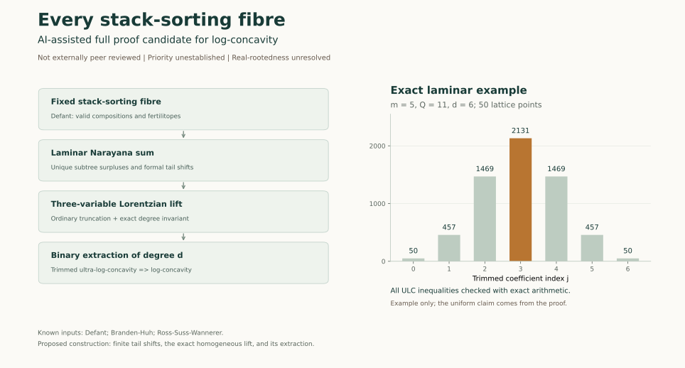

# Log-concavity of every stack-sorting fibre

**Status: AI-assisted full proof candidate for the log-concavity question.** Independent AI-assisted mathematical reviews and exact computational checks have found no gap. This is not external human peer review, formal proof-assistant verification, or confirmation of historical priority.

The proposed result answers the general log-concavity question explicitly raised immediately after Conjecture 31 on page 37 of Colin Defant's *Stack-Sorting Preimages of Permutation Classes* (2020). It does **not** prove the stronger real-rootedness Conjecture 31, nor the equivalent real-rootedness conjectures in *Fertilitopes* (2023).



The diagram separates the established fertilitope/Lorentzian inputs from the proposed tail-shift and lift construction. Its plotted example is supplementary; the candidate proof is uniform in all permitted sizes and weights.

[Final internal verification](review/FINAL_VERIFICATION.md) records the fresh full-source review, independently reproduced outputs, bounded prior-art search, and PDF rebuild limitation. The proof source and supplied PDF remain unchanged.

## Precise result

For a permutation π of [n], n ≥ 1, let k = des(π), and assume its fibre under West's stack-sorting map s is nonempty. If f_j(π) counts the permutations σ with s(σ)=π and des(σ)=j, set d=n−2k−1. The proof candidate shows that

A_π(x) = ∑_{j=0}^d f_{k+j}(π)x^j

has positive coefficients and that the sequence f_{k+j}(π)/binom(d,j) is log-concave. Thus the full descent distribution on every fibre, including its forced outside zeros, is log-concave. Empty fibres have the zero sequence and are handled separately.

The general theorem proves the corresponding trimmed ultra-log-concavity for Narayana-product sums over every integral laminar nestohedron with positive singleton weights. The proof is uniform in the permutation size, tree shape, and weights. Finite checks are supplementary, not a substitute for the argument.

## Files

- `proof/`: complete editable LaTeX proof draft and compiled PDF.
- `review/independent_mathematical_review.md`: independent reconstruction, exact hypotheses, and endpoint review.
- `review/lorentzian_lift_review.md`: homogeneous-lift audit and exact computational evidence.
- `review/literature_and_scope.md`: primary-source checks, attribution, current bounded prior-art search, and scope limits.
- `verification/check_permutation_fibres.py`: direct exhaustive permutation check, independent of the polytope code.
- `verification/check_laminar_lift.py`: exact lattice-point, finite-tail, homogeneous-lift, ULC, Hessian, and support checks.
- `verification/check_failed_strengthenings.py`: exact counterexamples to stronger proposed proof mechanisms, not to the original conjecture.
- `verification/*_output.txt`: actual rerun outputs from the packaged programs.
- `verification/direct_composition_example.json`: complete explicit 50-point example.
- `SHA256SUMS`: checksums of every other file in this directory.

## Reproduce the checks

The main theorem checks use only Python's standard library:

```sh
python3 verification/check_laminar_lift.py
python3 verification/check_permutation_fibres.py --max-n 10
```

The exhaustive check through n=10 scans 4,037,913 permutations and 89,261 nonempty fibres across all sizes. The laminar check uses 204 deterministic cases, scans 12,492 positive compositions, and performs 22,088 exact quadratic-Hessian tests. These are exact integer or rational computations, not floating-point root tests.

The optional failed-strengthening certificates use SymPy:

```sh
python3 -m pip install -r verification/requirements_optional.txt
python3 verification/check_failed_strengthenings.py
```

Use a virtual environment if installing dependencies. `verification/ENVIRONMENT.txt` records the tested versions. The programs perform no network operations and require no credentials. Rebuilding the PDF uses a standard LaTeX installation; build commands are in `proof/BUILD.md`.

Verify the package before use with Python 3.9 or newer:

```sh
python3 verify_bundle.py
```

On systems providing `sha256sum`, `sha256sum -c SHA256SUMS` is an equivalent check.

## Attribution and limitations

Defant supplies the question, valid-composition machinery, the refined fertility formula, and the fertilitope characterization. Brändén and Huh supply the Lorentzian framework and the binary-form/ultra-log-concavity criterion. Ross, Süss, and Wannerer supply the coefficient-preserving coordinate-truncation theorem. These are known ingredients, not new claims of this draft. Defant also suggested investigating a Lorentzian connection; that general suggestion is prior work. The proposed contribution is the specific formal tail-shift representation and exact three-variable Lorentzian lift applied uniformly to all laminar Narayana sums.

No personal author, affiliation, endorsement, journal acceptance, or license has been invented for this review version. The evidence of review consists of AI-assisted checks described above. A future publisher should retain these qualifications, confirm attribution and applicable repository licensing, and conduct independent human mathematical review. A search finding no previous proof does not establish priority.
